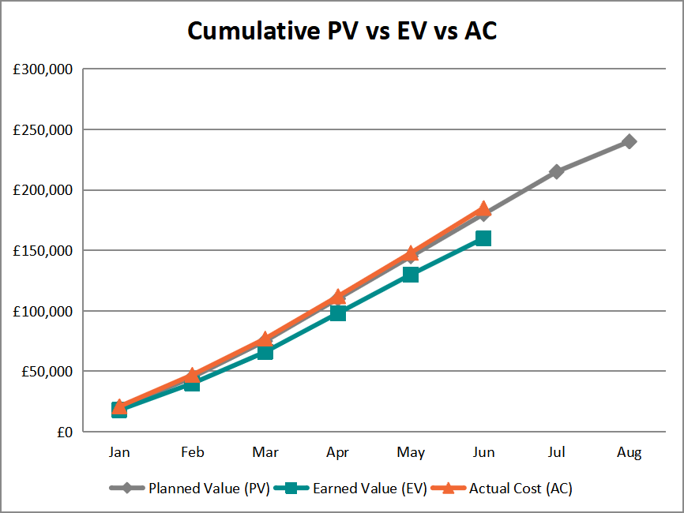

# 📈 Earned Value Project Tracker (Excel)

A working **Earned Value Management (EVM)** tracker in Excel. Enter planned value, earned value and actual cost each period, and it calculates **cost and schedule performance, forecasts, and RAG status** automatically. It's built with live formulas, so it recalculates when the inputs change.

> **Author:** Hassan Khan · Project Manager
> **Example project:** restaurant POS upgrade, 8 months, £240,000 budget (fictional)

---

## 📥 Download
**[`EVM-Project-Tracker.xlsx`](EVM-Project-Tracker.xlsx)**, with three sheets:
- **Summary:** pick a status period; every variance, index and forecast updates.
- **EVM Data:** period-by-period inputs, variances and a PV/EV/AC chart.
- **How to Use:** instructions and colour key (blue = input, black = formula).

---

## 📊 Status at Month 6 (example)

| Measure | Value | Meaning |
|---------|------:|---------|
| Planned Value (PV) | £180,000 | Work that should be done by now |
| Earned Value (EV) | £160,000 | Value of work actually done |
| Actual Cost (AC) | £185,000 | What that work cost |
| Cost Variance (CV = EV − AC) | **−£25,000** | Over budget |
| Schedule Variance (SV = EV − PV) | **−£20,000** | Behind schedule |
| CPI (EV ÷ AC) | **0.86** | £0.86 of value per £1 spent 🔴 |
| SPI (EV ÷ PV) | **0.89** | Progressing at 89% of planned pace 🔴 |
| Estimate at Completion (BAC ÷ CPI) | **£277,500** | Forecast final cost |
| Variance at Completion (BAC − EAC) | **−£37,500** | Forecast overspend |
| TCPI | **1.45** | Remaining work must be 45% more efficient to finish on budget |

### What a PM does with this
A TCPI of 1.45 means finishing on the original budget is **not realistic**. The honest options to take to the steering committee are:
1. **Re-baseline** to around £277,500 with a clear explanation of the causes, or
2. **Reduce scope** (e.g. move lower-priority features to a later phase), or
3. **Recover efficiency** in specific areas (e.g. replace a slow vendor process), backed by evidence.

The value of EVM is that it raises this **at month 6, not at month 8**, while there is still time to act.

---

## 🧮 Formulas Used

| Metric | Formula |
|--------|---------|
| Cost Variance | CV = EV − AC |
| Schedule Variance | SV = EV − PV |
| Cost Performance Index | CPI = EV ÷ AC |
| Schedule Performance Index | SPI = EV ÷ PV |
| Estimate at Completion | EAC = BAC ÷ CPI |
| Estimate to Complete | ETC = EAC − AC |
| Variance at Completion | VAC = BAC − EAC |
| To-Complete Performance Index | TCPI = (BAC − EV) ÷ (BAC − AC) |

RAG rule used: **Green ≥ 0.95 · Amber ≥ 0.90 · Red < 0.90**

Raw data: [`data/evm-data.csv`](data/evm-data.csv)

---

## 🛠️ Skills Demonstrated
`Earned Value Management` · `Cost Control` · `Schedule Control` · `Forecasting` · `Excel Modelling` · `Executive Reporting`

---

⭐ Part of my project management portfolio. Fictional example project and figures. Contact: khanhassan718@yahoo.com
